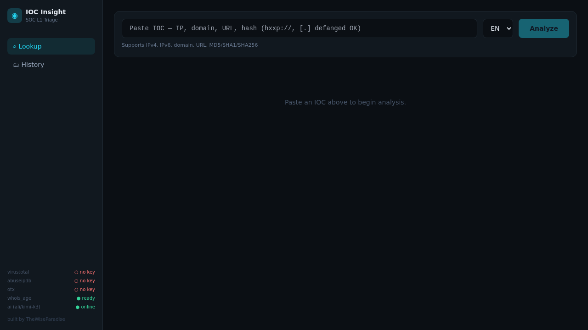
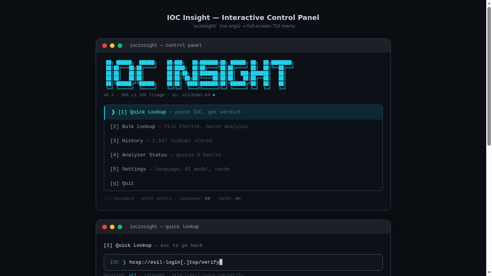
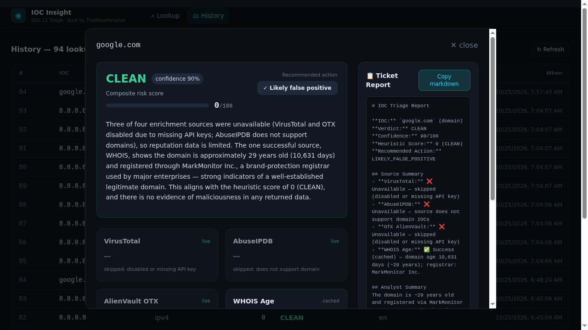

# IOC Insight

AI-powered IOC triage for SOC L1 analysts. Paste any indicator — IP, domain, URL, or
file hash — and get multi-source threat-intel enrichment **plus an AI-generated
verdict, explanation, and recommended action** as a ticket-ready report, in
English, German, or Indonesian.

## Why not just use VirusTotal's website?

Existing OSS tools (ioc-triage, ioc-threat-intel, ioc_checker) stop at
"collect raw data from N sources". IOC Insight adds the layer they don't have:

- **AI verdict synthesis** — weighs conflicting sources into one verdict
  (`MALICIOUS / SUSPICIOUS / CLEAN / UNKNOWN`) with confidence and reasoning
- **Natural-language explanation** — EN/DE/ID, written for humans
- **Recommended action** — `BLOCK` / `ESCALATE_L2` / `LIKELY_FALSE_POSITIVE` / `MONITOR` / `INVESTIGATE`
- **Ticket-ready markdown report** — copy-paste straight into your ticketing system
- **Never blocked by AI** — if the AI provider is down, a deterministic heuristic
  verdict (0–100 risk score) is produced instead, clearly labeled

## Screenshots







## Features

- Auto-detect IOC type (IPv4, IPv6, domain, URL, MD5/SHA1/SHA256) — defanged input OK (`hxxp://`, `[.]`)
- Parallel async enrichment: **VirusTotal v3, AbuseIPDB, AlienVault OTX, WHOIS domain age, urlscan.io, GreyNoise, ThreatFox, URLhaus, MalwareBazaar** (9 sources)
- SQLite cache with per-type TTL (respects free-tier quotas) + per-provider rate limiting
- Deterministic composite risk score 0–100 (documented rules, no AI dependency)
- **MITRE ATT&CK mapping** from analyzer tags (T1110, T1071, T1566, …)
- **Telegram alerts** to your channel on MALICIOUS verdicts
- **AI Q&A over lookup history** — ask "which IPs were malicious?" in plain language
- **Bulk lookup** from CLI and web UI
- Three interfaces: **one-shot CLI**, **interactive TUI control panel** (textual), **web dashboard** (React)
- Every lookup persisted to a history DB, queryable via CLI, TUI, and API

## Quick start

```bash
# 1. clone + install (Python 3.11+, uv)
git clone <repo> && cd ioc-insight
uv venv && uv pip install -e ".[dev]"

# 2. configure
cp config.example.yaml config.yaml
export VT_API_KEY=...          # free: virustotal.com
export ABUSEIPDB_API_KEY=...   # free: abuseipdb.com
export OTX_API_KEY=...         # free: otx.alienvault.com
export HERMES_CUSTOM_API_VLEEE_NET_API_KEY=...   # AI provider key

# 3. run — pick your interface
./iocinsight.py                           # interactive TUI control panel
./iocinsight.py 8.8.8.8                   # one-shot CLI lookup
cd web && npm install && npm run build    # build the web UI once
uvicorn ioc_insight.api:app --port 8000   # web UI + API, single port
```

**Web dashboard:** after `npm run build`, everything is served from
`http://localhost:8000` — no separate frontend server needed. For phone
access, expose it with a Cloudflare quick tunnel:
`cloudflared tunnel --url http://localhost:8000`.

## Docker

```bash
cp .env.example .env   # fill your API keys
docker compose up --build
# → web UI + API on http://localhost:8000, data persisted in the ioc-data volume
```

WHOIS age works with **no API key at all** — you can try the tool immediately:

```bash
iocinsight google.com --no-ai
```

```
╭──────────────────────────── google.com (domain) ────────────────────────────╮
╰──────────────────────────────── score 0/100 ────────────────────────────────╯
Source      Result                                 Status  Fresh
whois_age   age 6954d                                  ok   live
lookup took 762ms · ai: off
```

## CLI reference

| Command | Description |
|---|---|
| `iocinsight <ioc>` | One-shot lookup (auto-detects type) |
| `iocinsight` | Interactive TUI control panel |
| `--lang en\|de\|id` | Report language |
| `--file iocs.txt` | Bulk lookup, one IOC per line (`#` = comment) |
| `--json` | Machine-readable output (pipe-safe) |
| `--no-ai` | Heuristic score only, skip AI layer |
| `--no-cache` | Bypass the result cache |
| `--copy` | Copy ticket report to clipboard |

## REST API

| Endpoint | Description |
|---|---|
| `POST /api/v1/lookup` | `{"ioc": "8.8.8.8", "lang": "en", "ai": true, "use_cache": true}` → full `LookupResult` |
| `GET /api/v1/history?limit=50&offset=0` | Past lookups, newest first |
| `GET /api/v1/history/{id}` | Full record of one past lookup |
| `GET /api/v1/health` | Analyzer readiness + AI reachability |

## Architecture

```
CLI (typer) ──┐
TUI (textual) ├─► Pipeline: normalize → cache → parallel enrich → score → AI → report
REST (FastAPI)┘        │
               ┌───────┴────────┬──────────┬─────────┬───────────┐
             VirusTotal AbuseIPDB   OTX    WHOIS    AI (OpenAI-compatible)
               └───────┴──────────┴────────┴─────────┴───────────┘
                    SQLite cache (TTL)      SQLite history
```

Plugin analyzer pattern: one file per source under `ioc_insight/analyzers/`,
implementing `BaseAnalyzer`. Adding a new source = adding one file.

## Testing

```bash
pytest tests/        # 160 tests, all HTTP mocked (respx)
```

## Configuration

All secrets via environment variables — `config.yaml` references them as
`ENV:NAME` and never stores keys. See `config.example.yaml`.

## Roadmap (Phase 2)

- Web dashboard (React + Vite) — mockups in `mockups/`
- urlscan.io, GreyNoise, Shodan analyzers · passive DNS · MITRE ATT&CK mapping
- AI Q&A over lookup history
- Docker packaging

## License

MIT

---

**Built by TheWiseParadise** — AI-assisted SOC tooling for L1 analysts.
Part of a cybersecurity portfolio: threat-intel aggregation, AI synthesis,
and analyst-first UX in one tool.
